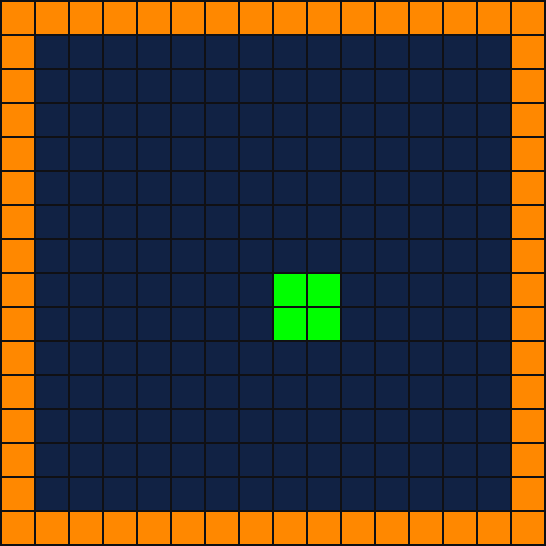

# DLSP

Digital Logic Sim project archive.

| Path | What it is |
| --- | --- |
| `PC_EYE_OS/` | Main library: 36 custom chips — NAND-based gates → adders → latches → registers → muxes/decoder/ALU → **a working 8-bit computer** → RGB screen → HDMI link. DLS 2.1.6. |
| `REFS/` | Scratch reference project: one chip showing the pinout of every built-in splitter, merger, bus and the RGB display. |
| `ANALYSIS.md` | Full review: format documentation, per-chip verification, and the defects found. |
| `tools/dlsp_sim.py` | Reader/simulator for the chip format — flattens any chip to NAND leaves and evaluates it. |
| `tools/build_hdmi.py` | Generator for the five HDMI/RGB-screen chips (they are machine-built, not hand-drawn). |
| `tools/build_os.py` | Generator for the twelve OS chips (`CONST 1` … `CPU 8`, `PC_EYE 8`). |
| `tools/kernel.py` | Two-pass assembler + the 67-word kernel; writes `tools/kernel.hex`. |
| `tools/boot.py` | Boots the machine in the simulator, prints the screen, writes `tools/os_screenshot.png`. |
| `tools/selftest.py` | Regression test: every OS chip's truth table + the kernel's boot frame. |
| `tools/rom_loader.md` | Why the ROM contents cannot live in a chip file, and how to load them. |

## Display chain

`DISP` was deleted. Its replacement is a five-chip HDMI/RGB display path:

```
  TMDS 9B ENCODER ──┐
                    │  19-pin cable
  HDMI TYPE A ──────┴──▶ HDMI DISPLAY ──▶ TMDS 9B DECODER ×3 ──▶ RGB SCREEN
                          (19 HDMI pins)                        (16×16, 4096 colours)
```

* **`RGB SCREEN`** — the screen. `ADDR[8]`, `RED[4]`, `GREEN[4]`, `BLUE[4]`,
  `WRITE`, `CLOCK`, `ON` in; `R OUT[4]`, `G OUT[4]`, `B OUT[4]` out. The LED inside
  it is the **on/off indicator** — `ON` also gates writes and the clock.
* **`HDMI TYPE A`** — all 19 Type A connector pins in physical order
  (`1 TMDS D2+` … `19 HPD`) plus differential receivers and a `LINK` detect.
* **`TMDS 9B ENCODER`** — transition-minimised 8b→9b TMDS coding (HDMI 1.4 §5.4.2,
  stage 1) with a popcount adder tree: 353 NAND gates. `TMDS 9B DECODER` inverts it.
* **`HDMI DISPLAY`** — connector → decoders (channel 0 = blue, 1 = green,
  2 = red) → screen.

## Quick start

```bash
python3 - <<'PY'
import sys; sys.path.insert(0, 'tools')
import dlsp_sim as S
p = S.Project('PC_EYE_OS')
print(p.run('8BIT FULL ADDER', {'IN A': 200, 'IN B': 100}))   # {'SUM': 44, 'OF': 1}
e = p.run('TMDS 9B ENCODER', {'D': 0x9C, 'DE': 1})            # {'Q': ..., 'Q8': ...}
print(p.run('TMDS 9B DECODER', {'Q': e['Q']}))                # {'D': 156}
PY
```

## Operating system

`PC_EYE_OS` is not just a chip library any more — it boots.

```
  POWER, CLK ──▶ PC_EYE 8 ──┬── CPU 8 ──▶ ADDR, R, G, B, WRITE ──▶ RGB SCREEN
                            │     │
                            │     └── ROM 256x16 ◀── tools/kernel.hex
                            └── 2379 NAND gates, 16x16 panel, 12-bit colour
```



* **Kernel** (`tools/kernel.py`, 67 words): POST floods the panel white, then
  paints the desktop, draws the amber window frame, and settles into the idle
  loop — a 2×2 green cursor that blinks.
* **CPU** (`CPU 8`): 8-bit single-cycle machine, `CLK` + `POWER` only. Program
  counter, accumulator, X index, three 4-bit colour registers and a Z flag, all
  in master/slave registers with a `¬POWER` reset mux. ISA: `NOP/LDI/LDX/ADDX/
  CMPX/SETC/PIX/JMP/JZ/ADD/AND/XOR/HLT`.
* **Boot proof**: `python3 tools/boot.py` — runs the real simulation and prints
  the frame. `settled: True`.

```bash
python3 tools/kernel.py     # assemble the kernel -> tools/kernel.hex
python3 tools/boot.py       # boot it, print + screenshot the screen
python3 tools/selftest.py   # truth tables + boot regression (exit 0 = all good)
```

The ROM contents are **not** part of the chip file (the format has no field for
them); see `tools/rom_loader.md`.

## Open issue

`4 PIN LOCK` is missing the wire from its `1-4BIT` merge output to the chip's
`OUT` pin, so the chip always returns 0. Nothing else in the library uses it any
more, but it is still broken. See `ANALYSIS.md` §5, finding B1.
